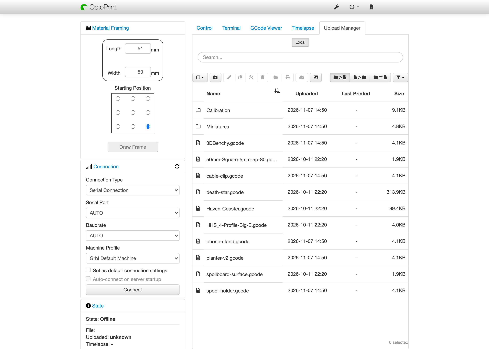
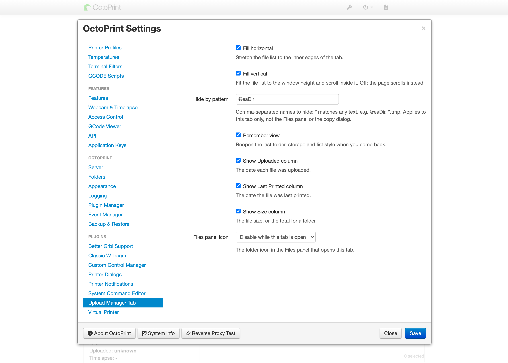
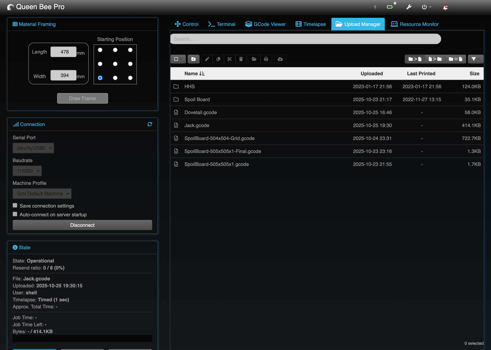
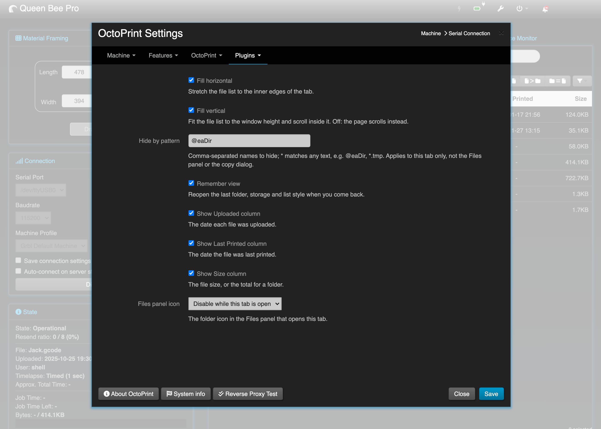
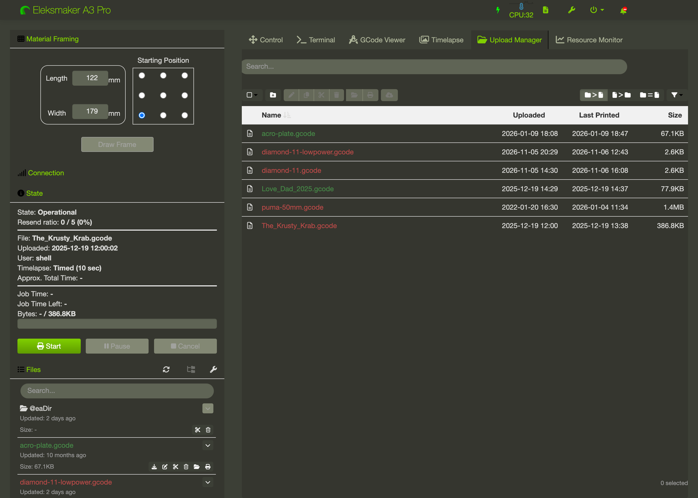
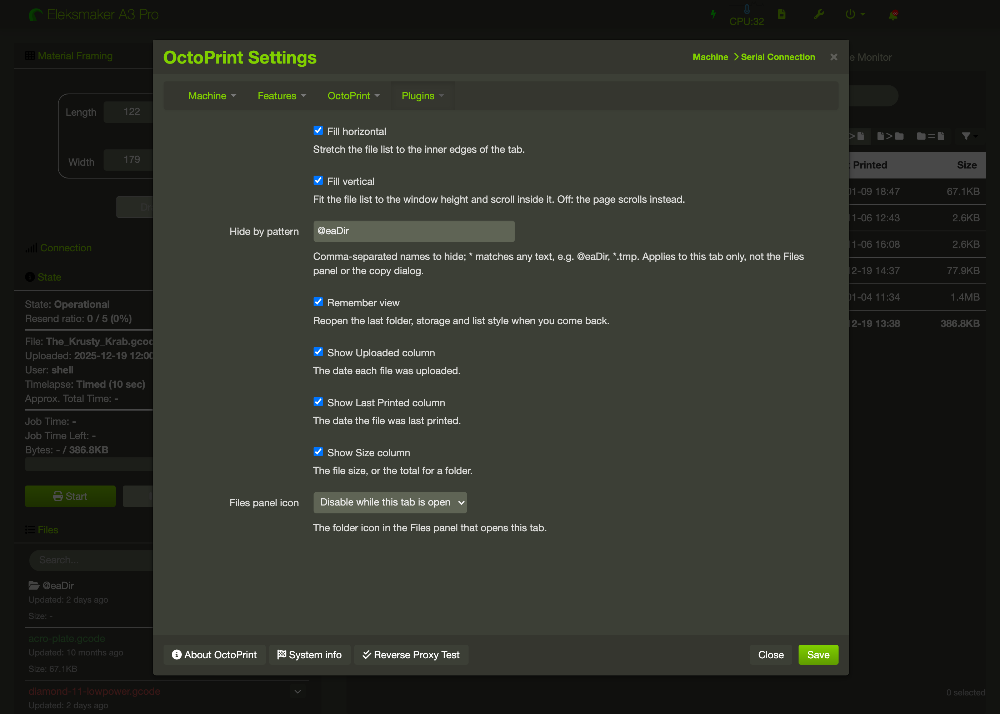

[](https://synman.github.io/OctoPluginStats/#uploadmanagertabContainer)
# Upload Manager Tab Plugin for Octoprint

Shows OctoPrint's Upload Manager in a tab instead of a dialog.

OctoPrint's bundled Upload Manager opens as a pop-up window over the page. This plugin moves that same
window into its own **Upload Manager** tab, so your printer's files stay one click away with nothing
covering the page. It adds no new file features. Printing, moving and removing files all work the way
OctoPrint already does them.



Here are some of Upload Manager Tab's capabilities:

* Shows OctoPrint's bundled Upload Manager in a tab, with nothing covering the page
* Stretches the file list to fill the tab across, down, or both
* Hides names you never want to see, such as `@eaDir` on a NAS share, using simple patterns
* Reopens your last folder and list style when you come back
* Shows or hides the Uploaded, Last Printed and Size columns
* Grays or hides the Files panel's folder icon
* Works on OctoPrint 1.11 and 2.0, and with UI Customizer

## Prerequisites

- OctoPrint 1.11.0 or newer. Tested on 1.11.8 and 2.0.0rc5 (proof: `tests/uploadmanagertab-probe.py` run on each). Other versions are expected to work but are not tested.
- The bundled **Upload Manager** plugin enabled (it ships with OctoPrint).

## Install

Install from the OctoPrint Plugin Manager using this URL:

```
https://github.com/synman/OctoPrint-UploadManagerTab/archive/main.zip
```

Full steps, uninstall and upgrade notes are in [docs/install-guide.md](docs/install-guide.md).

## Usage

Open the **Upload Manager** tab at the top of OctoPrint. Use the eight settings under
**Settings > Upload Manager Tab** to choose the columns, the layout and what is hidden.

The day-to-day guide, with a printer example for every setting, is
[docs/operators-guide.md](docs/operators-guide.md).

Something not right? See [docs/troubleshooting.md](docs/troubleshooting.md). Unfamiliar word? See
[docs/glossary.md](docs/glossary.md).

## Known limits

- **Hide by pattern** applies to this tab only. The Files panel and the copy dialog still show every file.
- **Remember view** is stored in each browser, not on the printer. A new browser or a cleared browser
  starts from OctoPrint's default view.
- Apart from its folder icon, the Files panel is unchanged. The copy dialog is unchanged.

## Project structure

```
octoprint_uploadmanagertab/   the plugin package
  __init__.py                 settings defaults, tab and settings templates, update hook
  static/js/uploadmanagertab.js   moves the bundled dialog into the tab
  static/css/uploadmanagertab.css
  templates/                  the settings form (the tab template is empty by design)
docs/                         operator, install, troubleshooting and glossary guides
docs/images/                  screenshots used in this file
tests/uploadmanagertab-probe.py   live browser probe (development only)
pyproject.toml, setup.py, MANIFEST.in   packaging
```

## Development

The probe drives a running OctoPrint with a headless Chromium browser through Playwright.

```
pip install playwright
playwright install chromium
UMT_BASE=http://127.0.0.1:5000 UMT_RIG=<folder holding an apikey file> python3 tests/uploadmanagertab-probe.py
```

- `UMT_BASE` is the URL of the OctoPrint instance under test.
- `UMT_RIG` is the folder that holds a text file named `apikey` with that instance's API key.
- The probe creates test files and folders, changes settings and restores them, so point it at a test instance, never a printer in use.
- `UMT_ONLY` (optional) is a comma list of check numbers to run.

The probe prints one PASS or FAIL line per check and exits non-zero on any FAIL.

To build an installable zip, run `python3 -m py_compile octoprint_uploadmanagertab/*.py setup.py`
and then zip the repository, excluding `.git`, under one top folder.

## Keeping the docs current

Update `docs/operators-guide.md` when `get_settings_defaults` or the settings template changes. Update the tested versions here and in `docs/install-guide.md` after running the probe on a new OctoPrint release.

## Contributing

Open an issue or a pull request on GitHub. Keep changes to the plugin's behaviour in step with the
guides in `docs/`, and keep the bundled Upload Manager's behaviour out of this plugin.

## Screenshots

**Stock OctoPrint 2.0**




**OctoPrint 1.11.8 with UI Customizer, on a CNC machine**





**OctoPrint 1.11.8 with UI Customizer, on a laser**





## License

AGPLv3. See [LICENSE](LICENSE).
